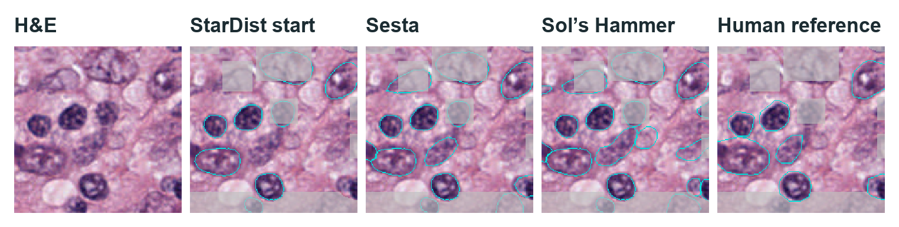

# Sesta Workbench

Sesta gives a vision model a place to inspect an image, mark what it sees and check the result against the source. An agent can move from a whole-slide overview to a single nucleus, save an observation at its original coordinates and reopen it for review. The local viewer works with Codex and Claude Code. The nuclear review workflow in this release uses GPT-6.2 Astra at low reasoning effort and Fast speed in Codex.

Version 2 adds a pathology toolbox and direct mask editing. The operator can separate touching nuclei with watershed, recover faint objects, remove debris, combine candidate masks in a region or draw an outline on the original pixel grid. The image stays available throughout the review.



Both workbenches started from the same StarDist mask on this breast field. Its instance F1 was **0.833** against the human outlines. Sesta’s edits reached **0.933** and Sol’s reached **0.632**. [Field notes and image credits](docs/gallery/README.md#one-starting-mask-two-edits)

## Choose how to review nuclei

| Mode | What the model does |
|---|---|
| **Tool-guided** | Inspect candidate overlays, select contours and combine local corrections. |
| **Model-guided** | Start with an empty mask, then draw or write image-processing code. |
| **Hybrid** | An independent reviewer chooses a starting mask for each field. The operator can switch tools, draw and revise. |

Before saving a hybrid result, the operator compares the raw image, initial contours and latest edit side by side. It selects which contours to keep and assigns cell types to those instances. A run saves the masks, choices and token usage.

## Try it

With Python 3.10 or later, run the following from this repository to open the practice viewer at `http://127.0.0.1:8790`.

```sh
python -m pip install ./packages/pathology-tools .
python -m sixth_magnitude demo --run runs/demo
python -m sixth_magnitude serve --run runs/demo --port 8790
```

For a nuclear review, register your H&E image in a workspace. A minimal `slides.csv` has the header `asset_id,path` and a row such as `sample,field.png`. This example takes the upper-left 256 × 256 pixels of the registered image and uses a signed-in Codex CLI for inference.

```sh
sixth-magnitude init --manifest slides.csv --run runs/slides
sixth-magnitude toolbox prepare --run runs/slides --asset-id sample --roi 0 0 256 256 --field runs/fields/F01
sixth-magnitude workbench --mode hybrid --fields runs/fields/F01 --output runs/review
```

[Codex and Claude Code plugin installation](docs/plugins.md) · [Whole-slide pathology walkthrough](docs/pathology.md)

## Results

These archived runs compare one operator with a reviewer and operator on the same images. F1 and Dice are image means against human annotations. The runs preceded the final side-by-side contour check.

| Sesta on 40 images | Operator | Reviewer + operator |
|---|---:|---:|
| Instance F1 · 20 typed nuclear fields | .802 | .841 |
| Typed instance F1 · same 20 | .389 | .408 |
| Instance F1 · 10 multi-tissue fields | .579 | .624 |
| Foreground Dice · 10 lung fields | .705 | .712 |
| Summed batch time | 14.80 min | 16.61 min |
| Total tokens, including cached input | 8.93M | 9.04M |

[Four image comparisons, fixed baselines and full tables](docs/gallery/README.md) · [Download field-level scores](docs/gallery/fields.csv)

[Sol’s Hammer](https://github.com/chaosbeagle/sols-hammer) is the independent workbench for batched review with GPT-6.2 Sol Ultrafast. The two projects share image tools and scoring definitions.

[Code license](LICENSE.md) · [Third-party notices](THIRD_PARTY_NOTICES.md) · [Image sources](docs/gallery/README.md#image-credits-and-terms)
