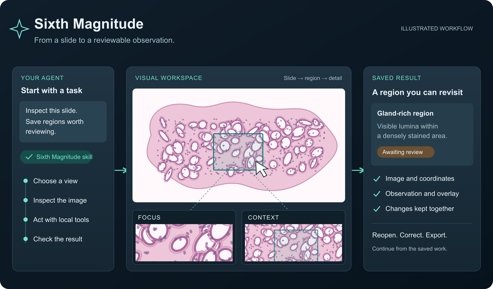
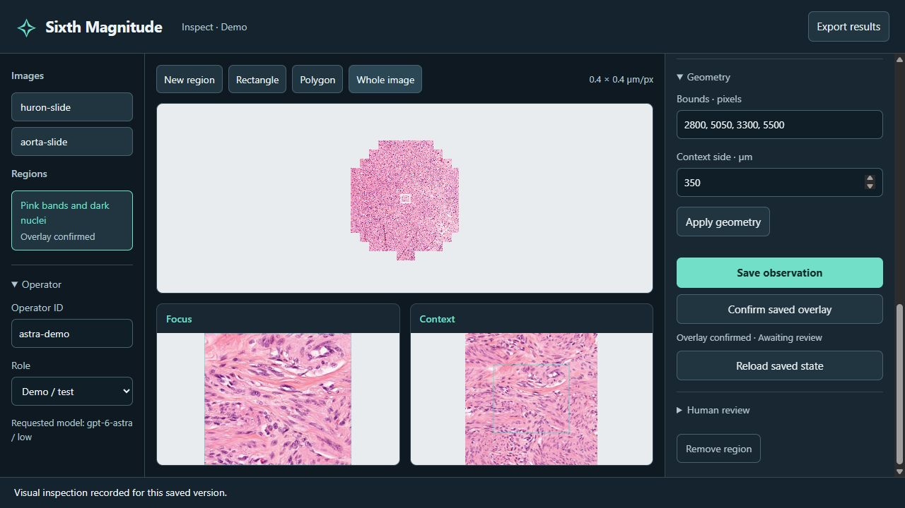

# Sixth Magnitude

[繁體中文](README.zh-TW.md)

A visual inspection framework for agents that can see and use tools.

Sixth Magnitude is designed for frontier vision models working inside agent environments such as Codex and Claude Code. Give an agent a task and an image workspace. It can move between an overview and fine detail, mark a region, describe what it sees, and check the result on screen. Each saved observation stays attached to its image and coordinates, ready to reopen, correct, or export.

The project combines a short skill, a local visual workbench, and Python tools. It uses the host agent's computer-use and coding capabilities: the model handles visual judgment, while the tools handle coordinates, image extraction, measurements, and storage. Task instructions can carry domain knowledge into the workflow without rebuilding the surrounding machinery for every task.

Pathology is the first worked example. Whole-slide images make the workflow concrete: examine tissue at several scales, keep a selected region in context, and leave observations that a pathologist can inspect and revise. The general workbench also accepts ordinary images; the lung pathology profile adds its own vocabulary and measurements.



## Why “Sixth Magnitude”?

The name began with Astra running at `low` reasoning effort. Among the settings used when the project started, `low` was sixth when counted down from the highest level. That suggested an astronomical name: sixth-magnitude stars lie near the [limit of unaided vision under a dark sky](https://science.nasa.gov/solar-system/skywatching/night-sky-network/check-your-sky-quality-with-orion/).

The image behind the name is a star chart assembled from many faint points. In the original pathology workflow, those points were candidate annotations: small observations with known locations, which a physician could check and correct. The framework gives them a place to accumulate and makes it possible to return to the evidence behind each one.

The project asks how much useful visual work a capable model can do with modest reasoning effort, clear instructions, and tools that take care of repetitive work. Astra `low` supplied the name; the skill and workbench can be used with other models and reasoning settings.

## Why start with Astra low?

The project began with an observation: GPT-6 Astra retains strong general visual capabilities even at `low` thinking effort. Published evaluations give that observation a concrete basis. On Artificial Analysis's MMMU-Pro evaluation of multimodal academic reasoning, Astra `low` scores above the previous GPT-5.6 Sol at both `high` and `max`:

| Model | Thinking effort | MMMU-Pro |
| --- | --- | ---: |
| [GPT-5.6 Sol](https://artificialanalysis.ai/models/gpt-5-6-sol-high) | high | 81.8% |
| [GPT-5.6 Sol](https://artificialanalysis.ai/models/gpt-5-6-sol) | max | 83.4% |
| [GPT-6 Astra](https://artificialanalysis.ai/models/gpt-6-astra-low) | low | **84.6%** |
| [GPT-6 Astra](https://artificialanalysis.ai/models/gpt-6-astra) | max | 86.9% |

OpenAI also reports gains over Sol in screen targeting and computer use: **92.7% vs. 76.9%** on ScreenSpot-Pro, and **72.6% vs. 65.7%** on the OSWorld 2.0 offline partial score. These are the launch report's best results across effort settings, not scores specifically for `low`. [Source and evaluation settings](https://openai.com/index/gpt-6-astra/).

This motivates the framework: give a visually capable model a workspace where it can act on what it sees, inspect the consequences, and leave usable evidence. The benchmarks inform that design; the WSI demo shows the workflow in practice. It is not a diagnostic accuracy study. [Benchmark details and further reading](docs/benchmarks.md).

## Install in your agent

For Codex:

```sh
codex plugin marketplace add chaosbeagle/sixth-magnitude
codex plugin add sixth-magnitude@sixth-magnitude
```

For Claude Code:

```sh
claude plugin marketplace add chaosbeagle/sixth-magnitude
claude plugin install sixth-magnitude@sixth-magnitude
```

Start a new session and ask the agent to **use Sixth Magnitude to set up an inspection demo in this workspace**. In Claude Code, you can also invoke `/sixth-magnitude:sixth-magnitude`. The plugin bundles the skill and workbench; the setup task installs Python dependencies in your working environment. [Installation and first-workspace guide](docs/plugins.md).

## Try the workbench

Requires Python 3.10 or newer. Run these commands from the repository:

```sh
python -m venv .venv
# Activate .venv in your shell, then:
python -m pip install -e .
python -m sixth_magnitude demo --run runs/surface
python -m sixth_magnitude serve --run runs/surface --port 8790
```

Open **http://127.0.0.1:8790/**. The example creates a synthetic image, so you can try the controls without a dataset or model connection.

1. Select or draw a region.
2. Examine the region and its surroundings.
3. Describe what is visible and save the observation.
4. Check the saved overlay, then confirm that it matches.
5. Export the results or reopen the workspace to continue.

The sample workspace keeps its observations separate from reviewed results.

## Work with an agent

Load the [Sixth Magnitude skill](sixth_magnitude/skill/SKILL.md) in your agent environment. Give the agent the workspace path, viewer URL, and task. For example:

> Inspect the marked surface for visible defects. Save each finding with a region and a short description. Check the saved overlays and leave uncertain findings for review.

The skill describes how to inspect images, choose a useful scale, save findings, and resume work. The browser provides visual access; the local tools handle image processing and storage. Choose the model and reasoning effort in your agent environment. The workbench does not require a separate model API connection.

```sh
python -m sixth_magnitude prompt --run runs/surface
python -m sixth_magnitude status --run runs/surface
python -m sixth_magnitude export --run runs/surface
```

The plugin uses the same skill and workbench as the manual setup above.

## Whole-slide inspection

The general workbench can open native whole-slide images. An agent can inspect a slide through computer use, save regions, and return to the image with the annotations in place. The screenshots use this general workflow on public pathology images.



See the [pathology walkthrough](docs/pathology.md) for slide registration, detailed views, and measurement definitions. [Demo image sources and permissions](docs/demo-sources.md) accompany the screenshots. The observations shown illustrate use of the workbench and remain candidates for expert review.

For lung pathology, a separate profile adds morphology fields, batch territories, and area measurements. Try its controls with a schematic example:

```sh
python -m sixth_magnitude demo --profile lung-pathology --run runs/pathology
python -m sixth_magnitude serve --run runs/pathology --port 8791
```

## Use your own images

Create a CSV following [examples/sources.csv](examples/sources.csv). Give each image a unique ID. Paths can be relative to the CSV or absolute on your machine.

```csv
asset_id,path,reader,mpp_x,mpp_y
surface_a,../data/surface.png,raster,,
```

```sh
python -m sixth_magnitude init --manifest examples/sources.csv --run runs/my-inspection
python -m sixth_magnitude serve --run runs/my-inspection
python -m sixth_magnitude export --run runs/my-inspection
```

PNG, JPEG, WebP, and BMP use the built-in reader. Native whole-slide formats use optional readers. Images without physical calibration use pixel coordinates; the lung pathology profile requires calibration.

Keep images and working folders out of the public repository. Reopening the same folder resumes saved work. Initialization requires an empty folder. Moving an existing workspace to another machine requires its image sources to remain available at the registered paths.

## Review and export

Each observation keeps its source, geometry, image evidence, and review status together. Editing the description or region clears the previous visual confirmation and human acceptance. Reviewers can correct findings in the same workbench.

Exports include JSON, CSV, Parquet, and image-coordinate GeoJSON. Candidate and accepted observations are separate. The workbench runs locally for one user; operator roles are selected in the interface.

- [Architecture](docs/architecture.md)
- [Workflow evaluation](docs/evaluation.md)
- [Development checks](docs/validation.md)
- [Contributing](CONTRIBUTING.md)

## Data and intended use

The workbench stores images and observations locally. When an agent uses a cloud model to inspect the workspace, screenshots and other content it sends are processed by that service under your account settings. Use images you are permitted to share with the selected service.

The pathology examples support research and workflow development. Candidate observations need expert review before clinical use; the project has not been clinically validated. Keep the local server on the loopback address. Interface roles label actions and are not user authentication.

Sixth Magnitude is an independent project. Model and agent product names identify the systems discussed and do not imply vendor endorsement.

## License

Project code is licensed under [MIT](LICENSE.md), copyright © 2026 Kuan Ting Wu. Bundled browser components retain their [licenses and notices](THIRD_PARTY_NOTICES.md); slide imagery follows its [source-specific terms](docs/demo-sources.md).
