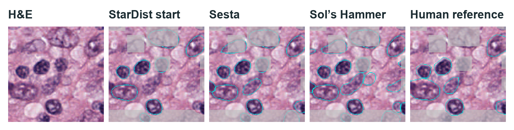
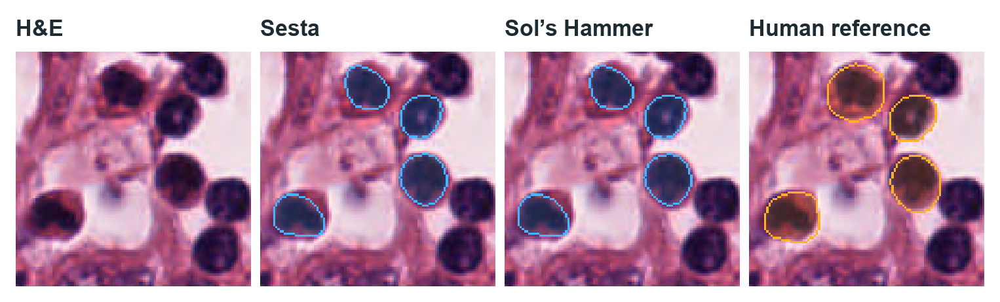
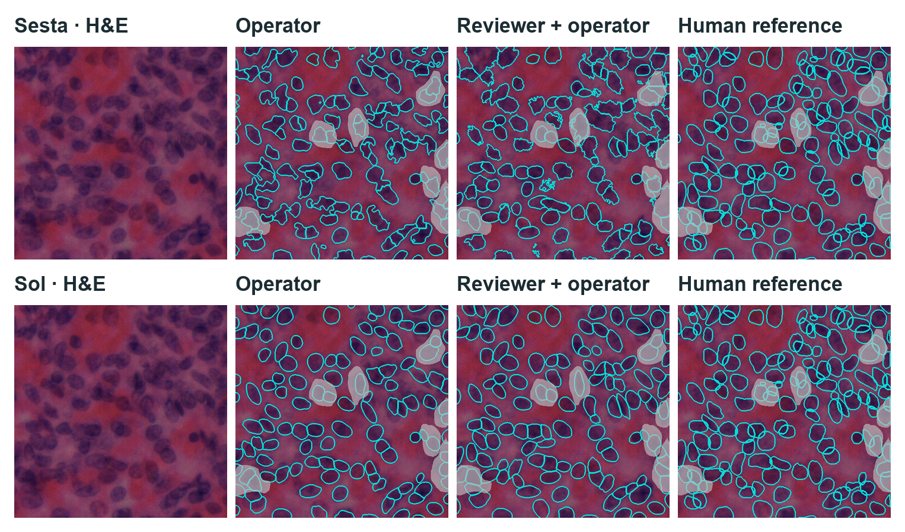
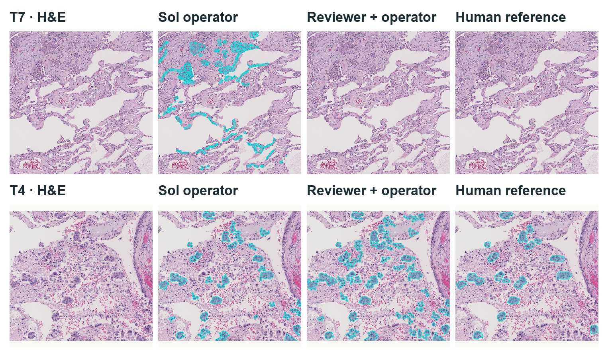

# Image gallery and results

How much does a second reader change a segmentation? We compared an operator working alone with the same operator receiving a starting mask and a visual assessment from an independent reviewer. Both could select tools, draw contours and assign cell types. Sesta used GPT-6.2 Astra low/Fast. Sol’s Hammer used GPT-6.2 Sol xhigh/Ultrafast.

The comparison covers 40 previously studied images, one run per condition. For the 20 typed nuclear fields, the single-role results come from an earlier run with matched settings and batches. The other 20 images were run in the same comparison round. Human annotations were available for scoring and figure assembly after prediction. The release adds a final side-by-side contour check after the workflow evaluated here.

## One starting mask, two edits

Both reviewers chose StarDist on this breast field. Its starting instance F1 was **0.833**. Sesta’s edits raised it to **0.933**. Sol’s edits lowered it to **0.632**. Cyan lines mark nuclei and gray marks excluded areas. In the current workbenches, the operator sees the source, start and proposed edit together before choosing which contours to save.

## Four nuclei found, four cell types missed

In kidney field H09, all four annotated neutrophils matched predicted nuclei. Both workbenches called all four lymphocytes, with or without a reviewer. Only these four matches are highlighted. The example shows why an operator may keep the outlines and revisit cell identity on the clean image.

## Recovering nuclei in a crowded field

N6 contains **159** scored nuclei. Sesta recovered 31 previously missed nuclei and lost 7 previous matches, taking its total from **41 to 65**. Sol recovered 26 and lost 8, moving from **55 to 73**. False positives also fell, from 69 to 53 for Sesta and from 52 to 41 for Sol. Gray areas were excluded from scoring.

## Empty lung fields and tumour extent

On T7 the reviewer–operator workflow removed all **296,920** false-positive foreground pixels. On T4, which contains annotated tumour, foreground Dice fell from **0.678 to 0.565**. The figure uses the workbench overview; the scores use the reference resolution. Across all ten lung fields Sol’s mean rose from **0.621 to 0.707**. Across the seven positive fields it fell from **0.602 to 0.582**.

## Scores against human annotations

Each image has equal weight. The fixed candidate is the original algorithm prediction. “Pair” means reviewer plus operator.

| Fields and metric | Fixed | Sesta solo | Sesta pair | Sol solo | Sol pair |
|---|---:|---:|---:|---:|---:|
| Typed nuclear fields (20), instance F1 | .552 | .802 | .841 | .767 | .793 |
| Same 20, typed instance F1 | — | .389 | .408 | .334 | .415 |
| Multi-tissue nuclear fields (10), instance F1 | .367 | .579 | .624 | .605 | .648 |
| Lung fields (10), foreground Dice | .332 | .705 | .712 | .621 | .707 |
| Positive lung fields (7), foreground Dice | — | .579 | .588 | .602 | .582 |
| Lung fields (10), typed foreground Dice | — | .621 | .615 | .492 | .586 |
| Lung fields (10), correct dominant pattern | — | 9/10 | 9/10 | 8/10 | 8/10 |

Instance F1 counts matches, false positives and missed nuclei. A typed match also requires the correct cell class. Foreground Dice measures pixel overlap; typed Dice requires class agreement within the overlap. Two empty foreground masks score 1. The dominant pattern is the class with the largest area, or background on an empty image. Dashes mark baseline metrics omitted from the archived summary. [Full-precision scores](performance.csv) · [80 paired field and workbench records](fields.csv)

### Modes on the same 20 typed nuclear fields

Each cell gives **instance F1 / typed instance F1**.

| Workbench | Tool-guided | Model-guided | Hybrid solo | Hybrid pair |
|---|---:|---:|---:|---:|
| Sesta | .806 / .368 | .810 / .382 | .802 / .389 | .841 / .408 |
| Sol’s Hammer | .824 / .399 | .691 / .372 | .767 / .334 | .793 / .415 |

### Time and usage across 40 images

| Workbench | Roles | Batch minutes | Total tokens | Cached input |
|---|---|---:|---:|---:|
| Sesta | Operator | 14.80 | 8,931,791 | 8,405,504 |
| Sesta | Reviewer + operator | 16.61 | 9,036,318 | 8,178,816 |
| Sol’s Hammer | Operator | 30.11 | 23,435,023 | 21,742,848 |
| Sol’s Hammer | Reviewer + operator | 31.53 | 27,718,646 | 25,358,592 |

Minutes sum the elapsed time of the batches. Paired totals include both roles. Total tokens include cached input, uncached input and output. Reasoning tokens are a subset of output. [Usage breakdown in seconds and tokens](usage.csv)

## Image credits and terms

The figures preserve field orientation and add workbench predictions and reference overlays. Source-specific terms apply to the images.

- **H08** uses breast tissue and reviewed nuclear annotations from Amgad et al., NuCLS, CC0 1.0. [NuCLS](https://sites.google.com/view/nucls)
- **H09** uses kidney tissue and cell annotations from Verma et al., MoNuSAC 2020. The source and adapted panel are licensed under CC BY-NC-SA 4.0. [MoNuSAC](https://monusac-2020.grand-challenge.org/Data/) · [License](https://creativecommons.org/licenses/by-nc-sa/4.0/)
- **N6** uses kidney tissue, instance outlines and exclusion regions from Mahbod et al., NuInsSeg. [Dataset and terms](https://zenodo.org/records/10518968)
- **T7 and T4** use lung adenocarcinoma growth-pattern data from Pan et al. and the TRACERx Consortium, available for academic noncommercial use. [ANORAK dataset and terms](https://zenodo.org/records/10016027)
