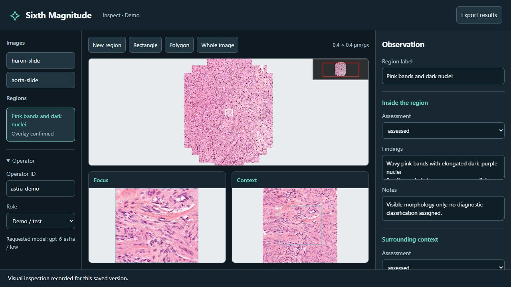
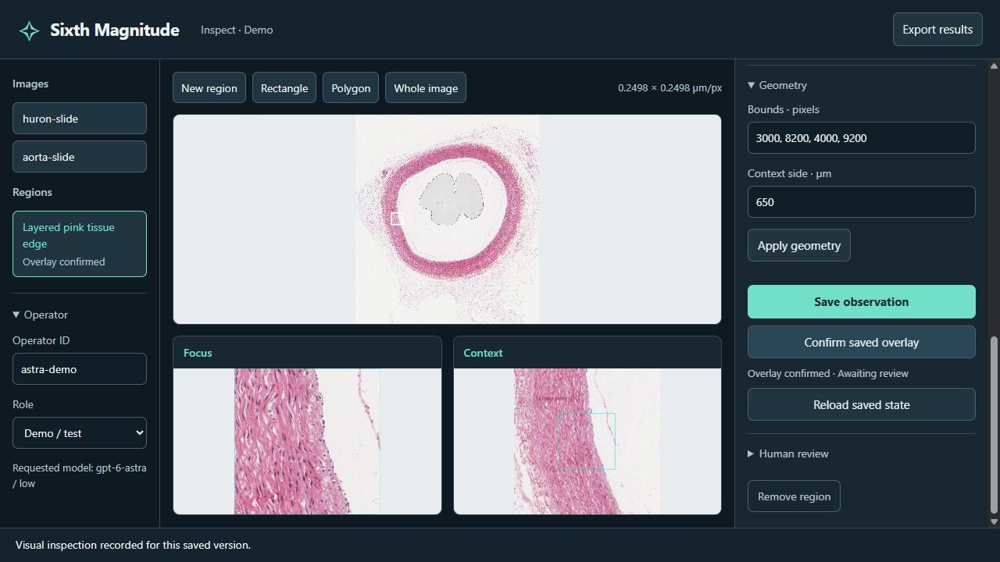

# Pathology walkthrough

Use the general workbench to inspect a whole-slide image, mark regions, and save observations for review. The screenshots below use this workflow on public pathology images. The `lung-pathology` profile adds lung morphology fields, pattern territories, and measurements when that dictionary applies to the tissue.

Choose the model and reasoning effort in your agent environment, then give the agent the skill, task, and viewer URL.

## Inspect a slide

Start with the slide overview and choose a region to examine. Zoom in when a boundary or small component needs more detail. Save a short description of what is visible, then check the annotation against the source image.



The focus/context views separate the selected region from its surroundings. Save an observation, inspect the final outline, and confirm that it matches what you examined.



The [image sources and permissions](demo-sources.md) are listed separately. These sources have no supplied lung cancer diagnosis. Their candidate observations illustrate viewing and saving; they are not lung growth-pattern reference annotations.

## Register slides

To use the slides shown here, download the two files linked in [Demo images](demo-sources.md). Save a CSV as `examples/my-slides.csv`, with paths pointing to your downloaded files:

```csv
asset_id,path,reader,mpp_x,mpp_y
huron,../data/Huron-1.tif,openslide,,
aorta,../data/JP2K-33003-1.svs,openslide,,
```

```sh
python -m pip install -e ".[openslide]"
python -m sixth_magnitude init --manifest examples/my-slides.csv --run runs/slides
python -m sixth_magnitude serve --run runs/slides
```

OpenSlide requires its native library. The optional extra installs the Python package and the binary distribution where available. iSyntax requires a compatible `pyisyntax-fastio` installation exposing the `isyntax` module. Native reader binaries and slide files are not bundled with the project.

The reader uses native micrometres-per-pixel (MPP) metadata when present. Otherwise, enter verified `mpp_x` and `mpp_y` values in the CSV or use the general profile in pixels. Conflicting overrides are rejected. Objective magnification alone is not used to infer MPP.

For tissue suited to the lung dictionary, add `--profile lung-pathology` to the initialization command. This profile requires physical calibration. Its root page is the compact territory workbench; `/review` opens detailed observations and physician review.

## Try the controls without a slide

```sh
python -m sixth_magnitude demo --profile lung-pathology --run runs/pathology
python -m sixth_magnitude serve --run runs/pathology --port 8791
```

This creates a schematic image with a simulated scale of 4 µm/px. It is a control exercise, not a source of diagnostic examples. Its observations stay outside accepted research results.

In the batch entry field, submit:

```text
T:B2,B3,C2,C3; A:B2; S:B3; ?:C2,C3
```

This creates four tumour-envelope regions, two typed regions, and two unresolved regions. Inspect the saved overlay and confirm the batch. Coverage and applicability remain incomplete, so the main measurements retain NA values and their reasons.

## Regions and territories

A detailed observation describes the selected focus and its surrounding context. A sampling rectangle defines what was inspected; it does not establish a tumour-area mask. Empty observation lists leave absence unspecified.

Territories define areas for measurement:

| Code | Meaning |
|---|---|
| `T` | Tumour envelope |
| `L/A/P/M/S/C` | Lepidic, acinar, papillary, micropapillary, solid, complex glandular |
| `?` | Unresolved pattern |
| `X` | Excluded area |
| `B` | Unassessable boundary |

Smaller supported territories override coarser ones. Equal-sized conflicting assignments remain unresolved. Whole-section coverage, dictionary applicability, and boundary assessability are declared separately.

The pattern dictionary applies to the nonmucinous lung adenocarcinoma spectrum. Record other histologies as not applicable when appropriate. STAS and other special observations remain located candidates outside the primary pattern-area denominator.

## Measurements

| Measurement | Definition | Unit |
|---|---|---|
| High-grade area | M/S/C area divided by assessable tumour area | % |
| Largest high-grade component | Largest four-connected high-grade component divided by all high-grade area | %, with mm² also reported |
| Edge enrichment | High-grade fraction in the inner edge band minus the central fraction | Percentage points |
| Pattern mixing | Different-pattern adjacent pairs divided by valid adjacent pairs | % |

The calculation uses a 64 µm grid, four-neighbour connectivity, and a 500 µm inner edge band. These are computational settings, not clinical thresholds. Incomplete typing, unresolved applicability, incomplete coverage, and missing denominators produce NA values with reasons. When no high-grade tissue is present, the largest-high-grade-component fraction has no denominator.

Candidate and physician-reviewed results are exported separately. Physician acceptance applies only to the content that was reviewed; changing the description or geometry requires a new review.
